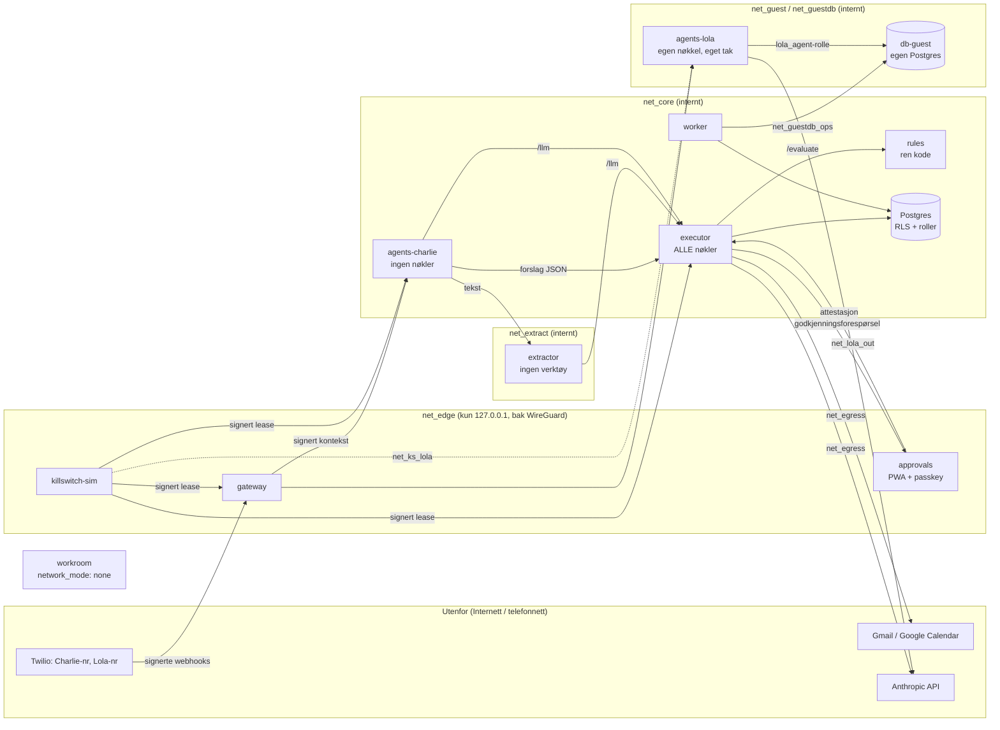

# Arkitektur

Hovedprinsipp: **sikkerheten sitter i vanlig kode utenfor modellen.** Modellene foreslår;
kode bestemmer. Ingen modell har nøkler, og ingen modell kan gi seg selv eller andre mer tilgang.

## Oversikt



Lola deler **ingen** nettverk med `executor`, `rules`, `agents-charlie`, `extractor`,
`approvals`, `worker` eller hoveddatabasen `db`. Gjesteområdet ligger i en egen
Postgres-instans (`db-guest`); worker når den via `net_guestdb_ops`, som Lola ikke er på (testet statisk i `tests/test_compose_isolation.py` og live i
`make demo`). Kill switch-simulatoren når Lola på et eget nett (`net_ks_lola`), slik at Lola
aldri havner på samme nett som Charlie-siden.

## Lag for lag

| Lag | Tjeneste | Hva den gjør | Hva den IKKE har |
|---|---|---|---|
| Kanaler | – | Telefon (to numre), SMS, chat (PWA), e-post, dørtelefon (alltid Lola), verkstedmikrofon | – |
| Inngang | `gateway` | Signaturkontroll (Twilio-skjema) på hver webhook, tak på forsøk per time, identitet (nummer, PIN, tvangskode, testord), modus, samtykke og samtykkelogg, hendelseskø, signerer samtalekonteksten | Ingen verktøy, ingen LLM, ingen leverandørnøkler |
| Regelmotor | `rules` | `evaluate(facts)`: nivå, tillit, kill switch, budsjett, rate, modus, bestillingstak. 170 linjer | Ingen database, ingen LLM, ingen nett ut |
| Utfører | `executor` | Eneste som kan handle. Godtar bare `proposal/v1`-JSON validert mot skjema per verktøy. Kortlivede HMAC-nøkler (60 s, engangs, bundet til verktøy + SHA-256 av parametre + idempotensnøkkel). LLM-proxy med kostnadstak for Charlie og uttrekkeren | – |
| Agenter | `agents-charlie` | Router (Haiku) → Sonnet ved behov. Ser bare uttrekk og strukturerte resultater | Ingen nøkler, ingen database |
| | `extractor` | Uttrekk fra utrygg tekst til fast JSON. Koden validerer alt etterpå | Ingen verktøy, ingen database, ingen Internett |
| | `agents-lola` | Resepsjon. Svar + én av tre handlinger (ingen / beskjed / forespørsel) | Ingen rute til Charlie-siden, ingen tilgang til `core`/`lager`/`audit` |
| Arbeidsrom | `workroom` | Kode, CAD, simulering. Volum `/work` | Ingen nett, ingen hemmeligheter |
| Godkjenning | `approvals` | Passkey (WebAuthn) og godkjenningsboks. Signerer attestasjoner | Ingen verktøy |
| Drift | `worker` | Lolas kø → uttrekker, sletting av rå transkripsjon etter 7 dager, loggeksport (WORM), heartbeat, anomalier → kill switch, ukesrapport, kostnadsvisning | Ingen leverandørnøkler |
| Nødstopp | `killswitch-sim` | Simulerer den uavhengige enheten (Pi Zero 2 W + SIM-HAT) | – |

## Én handling, fra ord til utført

1. Eieren ringer Charlie-nummeret. Twilio → `gateway` (signatur sjekkes). Samtykkemelding
   spilles. Kjent nummer → `owner_known`. PIN tastes (DTMF) → `owner_pin`.
2. Lyd → lokal tale-til-tekst → tekst til `agents-charlie` sammen med en **signert kontekst**.
3. `agents-charlie` sender teksten til **uttrekkeren**. Ut kommer validert JSON (intensjoner,
   flagg). Instruksjonslignende tekst er nøytralisert, ukjente/nivå 4-verktøy er fjernet.
4. Routeren (Haiku) får bare uttrekket og lager `RouterDecision` (svar + forslag).
5. Hvert forslag sendes til `executor` som `proposal/v1` sammen med den signerte konteksten.
6. `executor` validerer skjema, regner ut beløp fra lagrede priser, henter fakta (kill switch-
   lease, forbruk, antall kall, bestillinger denne måneden) og spør `rules`.
7. Nivå 1–2: kortlivet nøkkel → verktøyet kjøres → loggføres.
   Nivå 3: forslaget lagres; bekreftelsesteksten lages **av koden fra det lagrede forslaget**;
   godkjenningsforespørsel med tilfeldig utfordring til `approvals`.
8. Eieren godkjenner med passkey på telefonen (eller godkjenningsboksen ved store beløp).
   Enheten signerer `approve|forslag|parametre-hash|utfordring|metode|tekst-hash`.
9. `approvals` verifiserer mot registrert enhetsnøkkel og sender en signert attestasjon.
10. `executor` sjekker attestasjonen mot det lagrede forslaget, sjekker reglene på nytt,
    flytter status `pending → approved` atomisk (stopper replay), lager en kortlivet nøkkel og
    kjører verktøyet med **de lagrede parameterne**.

## Data

Postgres (Supabase-kompatibelt; migrasjoner i `supabase/migrations`). Skjemaer:

- `core` – hendelser, forslag, brukte nøkler, kostnader, verktøykall, heartbeats,
  samtykkelogg, rå transkripsjon (slettes etter 7 dager), uttrekk (beholdes), notater, prosjekter.
- `audit` – hash-kjedet logg; `audit.append()` er eneste skrivevei; UPDATE/DELETE/TRUNCATE blokkert.
- `guest` – gjesteinfo, Lolas kø (bare `untrusted`), beskjeder, Lolas eget forbruk. I drift
  brukes `guest` i den egne instansen `db-guest`.
- `lager` – ni tabeller: `lokasjon`, `lagerplass`, `artikkel`, `lagerregel`, `beholdning`,
  `bevegelse`, `batteri`, `leverandor`, `innkjopsforslag`.

Roller: `charlie_agent` (les), `lola_agent` (bare `guest`), `executor_svc`, `gateway_svc`
(kan skrive logg, ikke lese den), `worker_svc`, `extractor_svc` (ingenting). Testet i
`tests/test_db_roles.py`.

## Kill switch

Egen enhet med eget batteri, egen strøm og eget mobilnett. Ren tilstandsmaskin
(`killswitch/core.py`, 100 % dekning + property-tester). Enheten signerer en lease hvert
5. sekund; uten gyldig ACTIVE-lease stopper Charlie av seg selv. Tilstanden lagres på enheten
og overlever omstart. Enheten oppbevarer også forankrede hasher av revisjonsloggen.
Se `docs/killswitch.md`.

## Moduser

| Modus | Mikrofoner | Charlie |
|---|---|---|
| Vanlig | Tilkoblet (relé på), vekkeord | Nivå 1–2 via mikrofon; alt via telefon/app |
| Gjest (automatisk for ukjente) | Tilkoblet | Bare harmløse nivå 1-svar |
| Åpent verksted | **Fysisk kuttet** (relé av), kameraer uten lyd | Bare bakgrunn: lager, bestillinger, sensorer. Ingen tale til tekst noe sted |

## Kode

```
src/assistants/
  policy/        levels.yaml-laster (nivåer, invarianter)
  rules/         regelmotoren
  executor/      skjemaer, nøkler, håndterere, bekreftelsestekst, utfører
  approvals/     passkey/boks-verifisering, attestasjoner, PWA
  agents/        charlie (router), lola, extractor, report, mock_brains
  gateway/       kanaler, identitet, samtykke, hendelser
  identity.py    PIN, tvangskode, testord
  killswitch/    core (tilstandsmaskin), lease, driver (HAL + simulator)
  workshop/      moduser, mikrofon-pipeline
  inventory/     lagerrepo (Postgres + minne)
  notes/, lola_queue/, storage/, audit/, ops/ (kostnad, worker-jobber, månedstest)
  adapters/      alle eksterne tjenester: ekte + simulator
  services/      én FastAPI-app per container
  sim.py         hele systemet i én prosess med simulatorer (tester, eval)
  eval/          korpus-løper
```
